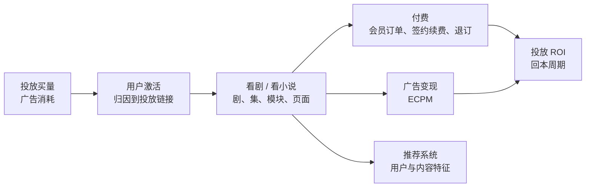

# 数仓成果

本页有两个项目：[项目一：短剧内容 App 数仓](#短剧内容-app-数仓)（当前工作）和 [项目二：数据中心建设](#数据中心建设)（上一段工作）。

## 项目一：短剧内容 App 数仓 {#短剧内容-app-数仓}

### 业务背景

公司做短剧和小说内容 App，有多条产品线。业务链路是：

数仓要回答的核心问题是：**每一笔投放花出去的钱，带来了多少用户、多少付费和广告收入，多少天能回本**。另外还要支撑内容运营看剧集表现、推荐团队取特征、会员运营看签约和退订。

### 技术架构

| 层 | 技术 | 说明 |
|---|---|---|
| 数据接入 | Flink CDC、Kafka、DataWorks 数据集成 | 业务库 MySQL、MongoDB 和埋点 Kafka 实时同步到 ODS |
| 离线计算 | MaxCompute（DataWorks 调度） | 老产品线的分层加工 |
| 查询与新链路计算 | StarRocks | 新产品线直接在 StarRocks 分层加工；老产品线 ADS 同步到 StarRocks 供 BI 查询 |
| 可视化 | Quick BI | 运营看板、投放报表 |
| 监控 | Python 脚本 | 数据新鲜度、Flink 任务失败、上下游对账 |

新产品线的数仓按 ODS / DIM / DWD / DWS / ADS 分层，目前仓库里有 ODS 43 张、DIM 10 张、DWD 15 张、DWS 12 张、ADS 26 张表的加工脚本，由团队共同维护。下面只写我自己负责的部分。

### 个人职责与成果

#### 1. 投放归因与 ROI 报表

- **业务问题**：投放团队要按投放链接看"花了多少钱、回了多少钱"。难点是一台设备可能先后被多个链接带来，订单和广告收入要归到正确的那次投放上。
- 采用 **last-touch 归因**：同一设备的相邻两次归因切出时间窗口，订单落在哪个窗口就算哪次投放。归因宽表保持 **设备 + 投放链接** 的粒度，避免按设备聚合时丢链接、按设备关联时笛卡尔放大。
- 在新产品线上移植老产品线的归因逻辑。老链路的 DWS 是每天重算全部历史的全量快照，新链路是按天增量，直接沿用会把"报表日收入"算成"归因日收入"。我改成 ADS 回订单事实表按 **设备 + 链接 + 归因日** 重算 D0~Dn 和累计收入，口径与老链路一致。
- 产出投放 ROI 日报和月报，以及支撑它们的归因 DWS、订单 DWD、推广链接维表、广告回传维表。

#### 2. 新用户留存与 LTV 报表

- **业务问题**：运营要同时看新用户"还在不在"（留存）和"带来多少钱"（LTV），并按平台、版本、渠道、是否付费拆分。
- 设计成**竖表**：每个新增日期按"第 N 天"一行，覆盖 12 个留存节点（次日到 365 日）和 10 个 LTV 节点。BI 端用 `MAX(IF(...))` 转成横表。增减观察节点只改 BI 查询，不用改表结构。
- **按活跃日期增量计算**：新增日期 D 的第 N 天只在 D+N 那天算一次，每天只覆盖一个分区，不回刷历史。
- StarRocks 不支持 `GROUP BY 固定列, CUBE(...)` 的混合写法，用 `GROUPING SETS` 显式展开 16 组维度组合，保证新增日期始终参与分组。
- 未到的天数写 NULL 而不是 0，避免把"还没到"误读成"流失"。

#### 3. 内容与商业化看板重构

- **剧集指标看板**：基于原来的全 App 天级看板（60 列），为单个产品线重构专属看板。先盘点旧链路和 BI 依赖，再定 52 个字段的契约，用 CTE 拆分事实避免 JOIN 放大。原看板中 8 个无法可靠归到剧的指标（点赞、收藏、分享、剧级广告收入等）直接删除，不做近似分摊。
- **商业化大盘**：区分**预估 ECPM**（预估广告收益 ÷ 曝光 × 1000）和**结算 ECPM**（结算收入 ÷ 曝光 × 1000）。结算收入依赖广告平台对账分摊，在对账逻辑完成前先预留字段，不让看板展示错误的数。
- 老产品线 ADS 用 DataWorks 数据集成从 MaxCompute 同步到 StarRocks，每张看板配套 MaxCompute 加工、StarRocks 建表、Quick BI 取数、对账校验四份脚本。

#### 4. 会员订单与签约数据

- 业务库的会员表通过 CDC 同步为主键表，每个 ID 只保留最新一行。基于它加工 DWD 全量快照时，直接全量读 ODS 后覆盖当天分区，不做"当日增量 + 昨日分区合并"。这样没有自依赖，也能看到删除。
- 加工会员状态表，关联账号表带出设备 ID，让会员数据能和归因、活跃数据按设备打通。
- 加工签约失败事件 DWS，支撑签约续费和退订分析。
- 评估订单表改 MaxCompute 事务表：单日快照千万级行，每天真实变化只有约 1/300，全量覆盖的写放大约 300 倍。结论是只有上游能给增量时 MERGE 才划算，上游只给全量时 MERGE 不省算力。

#### 5. 数据质量与链路稳定性

- 用 Python 脚本监控数据新鲜度、Flink 任务失败，并对 MySQL 和 StarRocks 做上下游对账。
- 总结 StarRocks 的分区裁剪规则：`dt = 常量` 只扫一个分区，`CAST(dt AS VARCHAR)` 等包裹写法会退化成全分区扫描。
- 推荐团队提出 15 秒内的实时数据需求时，判断直连 MySQL 只读从库比走数仓链路更合适：主从延迟是亚秒级，而数仓链路是分钟级准实时。

#### 6. 湖仓架构规划

- 参与湖仓一体方案规划：Flink 加 Paimon 做湖仓分层，DLF 统一元数据治理，StarRocks 做查询加速，OSS 统一存储，湖表作为唯一事实源。目标是解决 MaxCompute 和 StarRocks 两份数据、两套代码带来的一致性问题。
- 制定分阶段迁移路线：基础环境、技术验证与 10 分钟任务迁移、数据迁移、双跑验证、切换。方案目前在规划和验证阶段。

---

## 项目二：数据中心建设 {#数据中心建设}

**技术栈**：DataEase、FineReport、SuperSet、StarRocks、Iceberg、DolphinScheduler、MinIO、k8s

### 背景

入职时公司已有基础的数据中心，但数据仓库还处在初步搭建阶段。各业务系统的数据是割裂的，同一个指标在不同报表里口径不一致，很多分析还靠业务部门每天手工维护 Excel。

作为核心推动者，我从 0 到 1 规划并建设"数据中心"，围绕制造业的核心场景（计划、采购、营销等），重构数仓分层架构、统一指标口径、搭建数据产品体系，再通过 BI 看板和业务场景结合起来。目标是让公司从"把数据存下来"走到"用数据做决策"。

### 个人职责与成果

#### 1. 核心数据底座设计

- 针对多系统数据割裂、口径不一致的问题，主导设计了公司级的**数据仓库总线矩阵**。
- 基于 **Kimball 维度建模**方法完成重构，设计了覆盖营销、计划、采购、仓储等 **6 大核心域**的主题模型。
- 仓储出入库的业务类型很多（采购入库、销售出库、生产入库、调拨等），我把多来源的出入库数据做标准化，**构建了一张统一的库存流水明细事实表**，模型的一致性和可维护性都提高了。
- 建成清晰的 **DWD / DWS / ADS 分层架构**，为全公司的分析和应用提供**单一、可信的数据源**。

#### 2. 业务洞察与产品化

- 业务部门原来每天手工维护数据。我参与计划、采购、营销等业务流程，把其中的关键指标和业务逻辑抽象出来。
- 把原来依赖人工 Excel 的分析方式，转成**标准化、可复用的数据产品**。
- 搭建面向业务的**指标体系和标签体系**，提高数据复用率和分析效率。

#### 3. 数据产品交付与 BI 迁移

- 围绕业务核心关注的指标，独立负责**计划实时大屏、采购驾驶舱**等核心 BI 的设计和落地。
- 主导 BI 工具迁移（**SuperSet → FineReport → DataEase**），可视化层统一，业务侧无感切换。
- 建设指标统一层，保证多套 BI 系统的数据一致。

#### 4. 数据链路治理与数据保障

- 业务库表结构变更后，下游原来感知不到。我设计了**业务库核心表变更监控**，变更后自动发钉钉告警。
- BI 看板依赖的链路复杂，数据延迟会导致"上午看板不可用"。我设计并落地了**数据保障机制**：兜底策略、校验链路、分层更新。
- 优化调度依赖 DAG，降低任务之间的耦合度，缩小失败的传播范围。

#### 5. Iceberg → StarRocks 同步与性能优化

- 设计了 **Iceberg 全量/增量快照同步到 StarRocks** 的链路。
- StarRocks Primary Key 模型出现 **Compaction 压力大、CN 节点 CPU 飙升**的问题，我分析出根因是 merge、delete bitmap 和 rowset 膨胀。
- 用**分区级 overwrite 加动态分区隔离**替代全局更新。
- 重构表模型（调整 tablet 和分桶策略），优化数据分布，**下游调用平均耗时下降 60%**。
