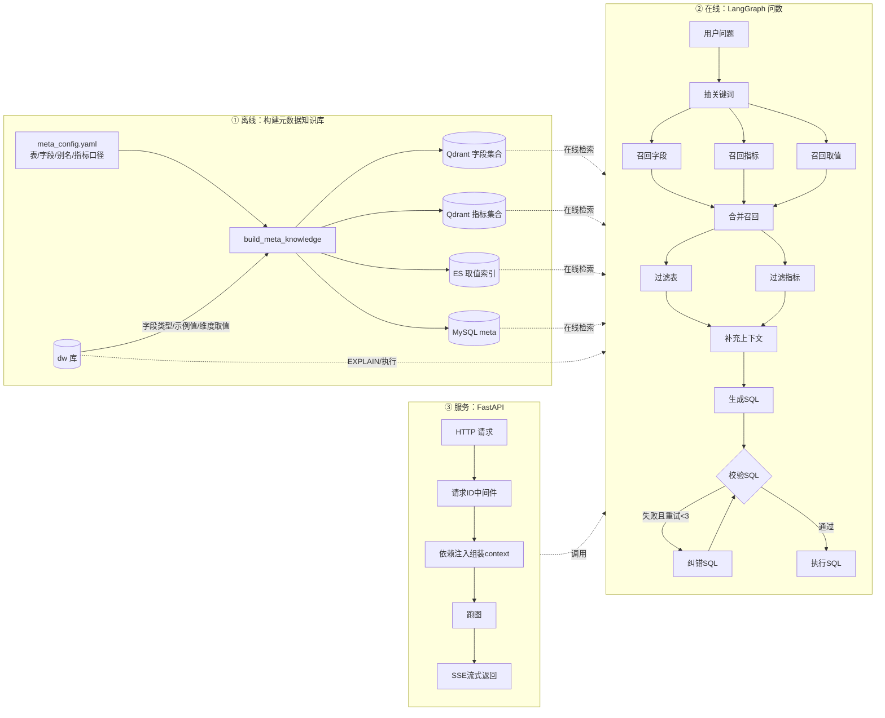

# 项目：Text2SQL 智能问数 Agent

**技术栈**：LangGraph、LangChain、qwen-plus、bge-large-zh-v1.5（TEI）、Qdrant、Elasticsearch（IK）、MySQL、SQLAlchemy、FastAPI、Docker Compose

## 一、项目一句话

业务人员用自然语言提问（例如"统计华北地区的销售总额"），系统自动找到相关的表、字段、指标和维度取值，生成 MySQL SQL，校验通过后执行，并把每一步进度和最终结果以流式方式返回给前端。

## 二、要解决的问题

大模型直接写 SQL 有三个根本困难，本项目的每个设计都对应其中一个：

| 困难 | 具体表现 | 本项目的对应设计 |
|---|---|---|
| 大模型不知道库里有什么 | 不知道表名、字段名，会编造不存在的字段 | 离线构建元数据知识库，在线按问题检索 |
| 用户说法和字段名不一致 | 用户说"销售额"，字段叫 `order_amount`；用户说"华北"，要落到 `region_name='华北'` | 字段用向量语义检索，取值用全文精确检索，关键词用大模型扩展同义词 |
| 生成的 SQL 可能是错的 | 语法错、字段错，执行直接报错 | EXPLAIN 校验，失败后大模型纠错并重新校验，最多 3 次 |

## 三、技术栈

| 层 | 技术 | 作用 |
|---|---|---|
| Agent 编排 | LangGraph（StateGraph + Runtime Context） | 把问数流程编排成有并行、有条件分支、有循环的图 |
| 大模型 | qwen-plus（OpenAI 兼容接口，LangChain ChatOpenAI） | 扩展关键词、过滤表和指标、生成 SQL、纠错 |
| 向量化 | 本地 TEI 部署 bge-large-zh-v1.5（1024 维） | 把字段名、描述、别名、指标转成向量 |
| 向量库 | Qdrant（data-agent-column、data-agent-metric 两个集合，Cosine） | 字段和指标的语义检索 |
| 全文检索 | Elasticsearch + IK 中文分词（data-agent-value 索引） | 维度字段真实取值的精确检索 |
| 元数据库 | MySQL meta 库（table_info / column_info / metric_info / column_metric） | 存表、字段、主外键、指标与字段的关系 |
| 业务库 | MySQL dw 库（星型模型：fact_order + dim_region / dim_customer / dim_product / dim_date） | 被查询的数据 |
| 服务 | FastAPI（lifespan + Depends + ASGI 中间件 + SSE 流式） | 对外提供 `/api/query` 接口 |
| 其他 | SQLAlchemy 异步、jieba、loguru、OmegaConf、Docker Compose | 数据库访问、分词、日志、配置、部署依赖服务 |

## 四、整体架构：三条链路首尾相接



三条链路的关系：

- 离线链路的产出（meta 库、Qdrant、ES）就是在线链路检索的输入。
- 在线链路需要的依赖（Repository、客户端），由服务链路的生命周期和依赖注入负责创建和释放。
- 服务链路给每个请求打上请求 ID，在线链路每个节点的日志都带上这个 ID，出问题时能从一次请求追溯到具体哪一个节点。

---

## 五、链路逐层拆解（每一层：问题 → 做法 → 产出 → 交给下一层）

### 链路①：离线构建元数据知识库

**问题**：大模型要写对 SQL，先得知道"有哪些表、字段叫什么、业务上怎么称呼、指标怎么算、维度有哪些取值"。这些信息分散在数据库结构和人的脑子里。

**做法**：

1. 用 `meta_config.yaml` 声明元数据：表和字段的角色（primary_key / foreign_key / dimension / measure）、业务描述、别名（如 `order_amount` 的别名是"销售额、订单金额、收入"），以及指标口径（GMV、AOV 及其关联字段 `relevant_columns`）。
2. 构建脚本连 dw 库，自动补全字段类型和示例值。
3. 按用途写入三种存储：

| 存储 | 存什么 | 为什么用它 |
|---|---|---|
| MySQL meta | 表、字段、主外键、指标与字段的关系 | 结构化信息，需要按 id 精确查询（合并召回时补主外键要用） |
| Qdrant | 字段的"名称 / 描述 / 每个别名"各存一个向量点，指标同理 | 用户说法和字段名不一致，需要语义相似度匹配 |
| ES | 维度字段的真实取值（如 region_name 的"华北"），只同步配置为 `sync: true` 的字段 | 取值必须精确匹配，见下文实测 |

**关键设计：取值为什么不用向量，而用 ES**

我用本地 bge 模型实测了几组取值的相似度：北京和南京 0.741，北京和天津 0.699，Mate60 和 Mate70 0.772。检索阈值是 0.6，这些全部会被误召回。而 WHERE 条件里的值错一个字结果就全错，所以取值必须走 ES 的分词精确检索。字段名则相反，需要"销售额能匹配到 order_amount"这种模糊能力，所以走向量。两者是分工协作，不是二选一。

**关键设计：构建脚本必须能重复运行（幂等）**

- 踩坑：Qdrant 的点 id 最初用 `uuid4`，每跑一次随机生成一批新 id，旧数据覆盖不掉。脚本跑了 4 次后，字段集合从 98 个点累积到 400 个点，同一个字段在检索结果里重复出现。
- 解决：id 改成 `uuid5(NAMESPACE_DNS, f"{字段id}:{文本}")`，同样的输入永远得到同样的 id，重跑就是覆盖；MySQL 写入从 `add_all` 改成 `session.merge`（有则更新、无则插入）；ES 文档 `_id` 固定为"表.字段.值"。
- 结果：连续跑两次，MySQL（table_info 5、column_info 24、metric_info 2、column_metric 2）、Qdrant（字段 98、指标 8）、ES（75）计数完全一致。

**产出 → 交给链路②**：一个可检索、可重复构建的元数据知识库。

### 链路②：在线问数（LangGraph 工作流）

**问题**：拿到用户问题后，要从知识库里找出"刚好够用"的上下文交给大模型。给多了会超长、干扰模型；给少了会缺字段写不出来。

**做法：12 个节点，按"召回 → 合并 → 精筛 → 生成 → 校验"组织**

| 阶段 | 节点 | 做什么 | 为什么这样设计 |
|---|---|---|---|
| 抽取 | extract_keywords | jieba 按词性抽关键词，并把原问题本身也作为一个关键词 | 原问题保留整体语义，关键词保留局部信息，两者互补 |
| 召回（3 路并行） | recall_column | 大模型扩展同义词后查 Qdrant 字段集合 | "销售总额"扩展出"销售金额"，提高召回率 |
| | recall_metric | 同上，查 Qdrant 指标集合 | 召回 GMV 这类有固定口径的指标 |
| | recall_value | 同上，查 ES 取值索引 | "华北"命中 `dim_region.region_name.华北` |
| 合并 | merge_retrieved_info | 把指标的关联字段、取值所属字段并入字段列表，按表分组，再从 meta 库补上每张表的主外键 | 召回不一定召回到关联字段，不补主外键大模型就不知道怎么 JOIN |
| 精筛（2 路并行） | filter_table / filter_metric | 大模型从合并结果里剔除无关的表和指标 | 召回追求"全"，精筛追求"准"，减少噪声 |
| 补充 | add_extra_context | 补数据库方言和版本、当前日期、星期、季度 | 处理"上个月""本季度"这类相对时间，按 MySQL 方言写函数 |
| 生成 | generate_sql | 大模型根据精简后的上下文生成 SQL | |
| 校验 | validate_sql | 在 dw 库执行 `EXPLAIN` | 不真正取数，只检查语法、表和字段是否存在 |
| 纠错 | correct_sql | 把报错信息交给大模型改 SQL，重试次数加 1 | |
| 执行 | execute_sql | 执行并返回结果 | |

**关键设计：校验-纠错闭环**

- 原始写法是"纠错后直接执行"，改出来的 SQL 不再校验，大模型改错了就在执行阶段报错。
- 我改成 `correct_sql → validate_sql` 的回边，用一个命名路由函数 `route_after_validate` 做三路分支：通过就执行，失败且重试次数小于 3 就纠错，达到 3 次就结束，避免无限循环。重试次数作为状态字段 `retry_count` 在图里传递。

**关键设计：并行节点和依赖管理**

- 三路召回在同一个超步（super-step）里并行执行，总耗时取最慢的一路，不是三路相加。
- 踩坑：只给了 recall_column 需要的依赖，没给 recall_value 需要的 ES 仓库，结果 recall_value 报 `KeyError`，同一超步里的 recall_column 也一起失败，看起来像是 recall_column 有问题。这让我明确了 LangGraph 的规则：同一超步内任一节点失败，整个超步失败。
- 踩坑：recall_metric 误用了字段仓库，查回来的是 `ColumnInfo`，到 merge 节点读 `.relevant_columns` 才报错。错误发生的位置和暴露的位置隔了一个节点。修正后改为查指标集合，召回结果从字段 id 变成了真正的指标 `['GMV', 'AOV']`。
- 所以把所有外部依赖统一声明在 `DataAgentContext`（TypedDict）里，通过 LangGraph 的 `context_schema` 在运行时注入，节点用 `runtime.context[...]` 取。节点本身不创建连接，方便测试和替换。

**实测结果**："统计华北地区的销售总额"走完全链路，生成 `dim_region JOIN fact_order ON region_id WHERE region_name='华北'` 的 `SUM(order_amount)`，结果 41099.5。

**产出 → 交给链路③**：一个可编译、可流式运行的图对象 `graph`，以及它需要的依赖清单 `DataAgentContext`。

### 链路③：服务化（FastAPI）

**问题**：链路②需要 6 个依赖（Embedding、两个 Qdrant 仓库、ES 仓库、meta 和 dw 两个 MySQL 仓库）。在测试脚本里是手动 init、手动拼装、手动 close，搬到 Web 服务里会遇到三个问题：每个请求都重建连接池太慢；一个请求 close 会关掉另一个请求正在用的连接；session 不能被多个请求共用。

**做法：按"生命周期长短"把对象分两类管理**

| 类别 | 对象 | 谁管理 | 生命周期 |
|---|---|---|---|
| 进程级 | MySQL 连接池、Qdrant / ES / Embedding 客户端 | `api/lifespan.py`（yield 之前 init，之后在 finally 里 close） | 服务启动到关闭，只建一次，所有请求共用 |
| 请求级 | MySQL AsyncSession、各个 Repository、`DataAgentContext` | `api/dependencies.py`（yield 依赖 + Depends 链） | 一个请求一份，响应发完后自动归还连接池 |

- 路由里只写 `context = Depends(get_data_agent_context)`，FastAPI 按依赖链依次创建 session、Repository、context。
- 流式响应的关键点：当前 FastAPI 版本中，yield 依赖的清理代码在流式响应全部发送完之后才执行，所以图在 `StreamingResponse` 里跑的整个过程中 session 都可用。最后一个节点 execute_sql 用 session 查库成功，证明了这一点。

**流式返回（SSE）**：用 `graph.astream(stream_mode="custom")` 接收节点里 `runtime.stream_writer` 写出的进度，每条转成 `data: {...}\n\n` 推给前端。用户能实时看到"召回字段 running → success → 生成SQL → 执行SQL → 结果"。流开始后 HTTP 状态码已经无法修改，所以异常也作为一条 `{"type":"error"}` 消息推送，而不是抛出。

**可观测性：请求 ID 贯穿全链路**

- 用纯 ASGI 写了 `RequestIDMiddleware`：请求头带了合法的 `X-Request-ID` 就沿用，否则生成 uuid；写入 `ContextVar`，并在响应头返回。外部传入的 ID 用正则校验（字母、数字、`-`、`_`，最长 64），防止注入换行伪造日志。
- loguru 配置 `patcher`，每条日志输出前自动从 ContextVar 读取请求 ID，业务代码一行不改。LangGraph 起的子任务会继承上下文，所以图里每个节点的日志都带上了同一个 ID。
- 为什么不用 `@app.middleware("http")`：那种写法下 `call_next` 在流刚开始时就返回了，"请求结束"日志和耗时会提前记录。纯 ASGI 写法要等最后一段数据发完才记，实测记录的总耗时是 9667ms，是真实值。

**产出 → 回到起点**：每次问数都有一个请求 ID，日志里能看到这次请求召回了哪些字段和取值、生成了什么 SQL、校验了几次。这些日志正是判断离线链路①的元数据（别名、描述、取值同步范围）是否需要补充的依据。比如某个问题召回不到字段，就回到 yaml 补别名，重新构建。三条链路由此形成闭环。

---

## 六、已知局限与演进方向

| 局限 | 原因 | 演进方案 |
|---|---|---|
| 还没有准确率评测 | 目前只验证了单个问题跑通 | 建 30~50 个"问题 + 标准答案"的评测集，每次改动后回归 |
| EXPLAIN 只能保证"能跑"，不能保证"算对" | 口径错、JOIN 错不会报语法错误 | 引入语义层（指标层）：大模型只选指标、维度、过滤条件，SQL 由程序按预定义口径确定性生成；现有 NL2SQL 图作为兜底 |
| SQL 由大模型自由生成，口径可能不一致 | GMV 每次可能被理解成不同算法 | 同上，口径固化在 metric_info 里由程序使用 |
| 缺少示例 SQL | 公司内部特有写法大模型不知道 | 加"问题-SQL"样例库，生成前按相似度检索做 few-shot |
| 删除不同步 | `merge` 只增改不删，yaml 删掉的字段库里还在 | 构建时对比差集删除，或按版本全量重建 |
| 无鉴权、无表级权限 | 课程项目阶段 | 只读账号、强制 LIMIT、接口鉴权、按用户做表级权限 |
| 复杂分析类问题（如"GMV 为什么下降"）答不了 | 固定工作流只做单次取数 | 用 Deep Agent 做规划和多步分析，把当前图包装成取数工具供其调用 |

**为什么当前选固定工作流而不是自主 Agent（Deep Agent）**：Text2SQL 的步骤是确定的，要求结果稳定、可复现、可调试。固定工作流每次走同一条路，成本低、出错能定位到具体节点；自主 Agent 每次要多轮规划，更慢更贵，结果也不稳定。自主 Agent 的价值在多步分析层，不在单次取数层。

### 元数据设计的演进方案（表从 5 张扩展到上千张时）

当前设计是"人工写 yaml → 构建脚本写入 MySQL、Qdrant、ES"。它的优点是业务语义由人明确给出、可控，三类存储按访问方式分工也是对的；但放到真实数仓会遇到以下瓶颈：

| 问题 | 具体表现 | 在真实数仓里的后果 |
|---|---|---|
| 全靠手写 yaml | 每张表、每个字段都要人写 | 几千张表写不过来；业务库改了字段，yaml 不知道，元数据和真实表结构逐渐脱节 |
| 缺少数仓特有元数据 | 只有主键、外键、维度、度量四种角色 | 没有分区字段、表粒度、全量快照还是增量、数据最新日期。大模型不知道要加 `dt` 过滤会扫全表，也分不清增量表和快照表的口径差别 |
| 指标只有描述，没有算法 | GMV 只记了关联字段和一句描述 | 怎么聚合、要不要剔除退款，仍由大模型临场发挥，口径不受控 |
| 表关联关系没有显式记录 | 只标了外键字段 | 表一多，大模型可能选错关联路径，或者一对多关联导致数据放大 |
| 三份存储没有一致性保障 | 分开写入，`merge` 只增改不删 | 中途失败三处不一致；yaml 删掉的字段检索时仍会被召回 |
| 取值全量同步 | 所有 `sync: true` 字段的每个取值都写入 ES | 客户名这类几百万个值的字段同步成本高，而且很快过时 |

对应的改进方案：

1. **元数据分两层**：技术元数据（表名、字段名、类型、注释、分区字段、主键）从 information_schema、数据地图或建表语句注释中每天自动采集；业务元数据（别名、描述、指标口径、粒度说明）由人工维护，覆盖在技术层之上。yaml 只写机器采集不到的业务语义。
2. **补充数仓特有元数据**：每张表增加分区字段、粒度（如"设备 + 链接 + 天"）、装载方式（全量快照 / 增量）、更新频率、数据最新日期，生成 SQL 时作为硬性规则交给大模型，例如"查询这张表必须带 `dt` 条件"。
3. **指标升级为语义层**：指标写成完整定义，由程序生成 SQL，大模型只选指标、维度和筛选条件。思路与数仓的统一指标口径一致，可参考 dbt MetricFlow、Cube 的指标定义格式：

   ```yaml
   - name: GMV
     expression: SUM(fact_order.order_amount)
     filters: [order_status = '已支付']
     time_column: dim_date.date_id
     allowed_dimensions: [region_name, category, brand]
   ```

4. **显式记录表关联关系**：存储"`fact_order.region_id → dim_region.region_id`，多对一"这样的关系，生成 SQL 时按关系找关联路径；对一对多关联提示"先聚合再关联"，防止数据放大。
5. **按版本号同步**：每次构建生成一个版本号，三处存储写入时都带上它，全部写完后再删除旧版本数据。构建中途失败不影响线上，yaml 删掉的字段也能真正清理。
6. **高基数字段在线查询**：省份、品类这类取值少的字段继续同步到 ES；客户名这类取值多的字段改为召回时直接在业务库做模糊查询，或只同步高频值。
7. **积累历史 SQL 样例库**：把数据开发写过的真实 SQL、用户确认答对的问答存成"问题 + SQL"样例，生成时检索相似样例作为参考，体现公司内部的写法习惯。

推荐优先级：

| 优先级 | 改进 | 理由 |
|---|---|---|
| 1 | 补数仓元数据（分区、粒度、装载方式） | 改动小，直接减少全表扫描和口径错误 |
| 2 | 指标改成完整定义，由程序生成 SQL | 解决口径不一致这个最根本的问题 |
| 3 | 技术元数据自动采集 | 表多了以后非做不可 |
| 4 | 显式记录关联关系 | 表多、关联复杂后价值才明显 |
| 5 | 版本号同步、高基数字段在线查询、历史 SQL 库 | 偏工程完善，规模上来后再做 |

当前只有 5 张表，手写 yaml 完全够用，以上方案属于规模扩大后的演进方向。

---
